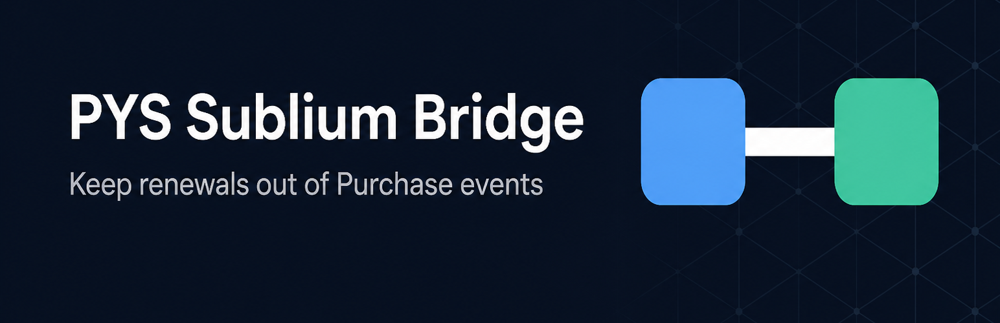

# EventRelay – Bridge for PixelYourSite and Sublium



**EventRelay** is an independent WordPress plugin by [Betatech](https://betatech.co/). It connects [PixelYourSite](https://www.pixelyoursite.com/) to [Sublium Subscriptions](https://sublium.com/), stops subscription **renewals** from being sent as **Purchase** events, sends PixelYourSite’s **FirstTimeBuyer** event on a customer’s first sale, and shows every decision on an admin dashboard.

This is a third-party integration. It is not affiliated with, endorsed by, or an official product of PixelYourSite or Sublium.

| | |
|---|---|
| Display name | EventRelay – Bridge for PixelYourSite and Sublium |
| Directory slug | `eventrelay-for-pixelyoursite-and-sublium` |
| Text domain | `eventrelay-for-pixelyoursite-and-sublium` |
| Admin menu | EventRelay |
| GitHub | [ashawkat/eventrelay-for-pixelyoursite-and-sublium](https://github.com/ashawkat/eventrelay-for-pixelyoursite-and-sublium) |

The WordPress.org plugin directory uses `readme.txt`. This file is the GitHub overview.

## Why it exists

PixelYourSite only enables “Exclude renewals from the Purchase event” when official **WooCommerce Subscriptions** is installed. Stores that use **Sublium** cannot turn those checkboxes on, so every automatic renewal is sent to connected pixels as a new Purchase.

That inflates conversion data. EventRelay does not fork PixelYourSite. It detects Sublium renewals and blocks those Purchase events using PixelYourSite’s own filters and APIs.

## What it does

- Blocks **Purchase** (browser + Conversion API / Measurement Protocol) for Sublium automatic and/or manual renewals
- Unlocks the greyed-out renewal checkboxes on PixelYourSite → WooCommerce Events
- Sends PixelYourSite’s **FirstTimeBuyer** event **with Purchase** on a customer’s first paid order
- Never sends FirstTimeBuyer on a Sublium renewal
- Keeps a readable **dashboard** of what was sent or blocked

### What you should see

| Order type | Purchase | FirstTimeBuyer |
|---|---|---|
| First paid checkout | Sent | Sent |
| Repeat one-time customer | Sent | Not sent |
| Sublium renewal | Blocked | Not sent |

## Requirements

`Requires Plugins` lists the WordPress.org slug for Sublium free only:

- WordPress 6.0+
- PHP 7.4+
- Sublium Subscriptions (`sublium-subscriptions-for-woocommerce`)
- PixelYourSite free or Pro (runtime check; Pro is not in the directory)
- WooCommerce 7.0+ (runtime; Sublium already depends on it)

Sublium Pro is an add-on and is not required. PixelYourSite Pro is detected without installing the free plugin.

## Install

1. Copy the `eventrelay-for-pixelyoursite-and-sublium` folder into `wp-content/plugins/`.
2. Activate **EventRelay – Bridge for PixelYourSite and Sublium**.
3. Open **EventRelay** in the WordPress admin menu.

## Settings

All of these live on the EventRelay dashboard:

- **Block automatic renewals** — scheduled Sublium charges do not fire Purchase
- **Block manual / early renewals** — customer-initiated or manual renewals do not fire Purchase
- **Send FirstTimeBuyer on first sale** — also turns on FirstTimeBuyer inside PixelYourSite
- **Keep this activity log** — last 150 decisions, also written to WooCommerce → Status → Logs (`eventrelay`)

Both renewal exclusions default to **on**.

## Dashboard

The **EventRelay** menu shows:

- Connection status (PixelYourSite, Sublium, logging)
- Totals: purchases sent, renewals blocked, FirstTimeBuyer sent, events today
- Filterable activity feed (All / Purchases / First-time / Blocked)
- Settings and a short “what you should see” checklist

## How renewal detection works

An order is treated as a Sublium renewal when any of these are true:

- `_sublium_wcs_subscription_renewal` is `yes` (Sublium’s canonical flag; same as `sublium_order_contains_renewal()`)
- `_sublium_wcs_subscription_payoff` is `yes` (installment payoff, treated like a renewal)
- `created_via` is `sublium_subscription_renewal` or `sublium_subscription_payoff`
- Official WooCommerce Subscriptions `_subscription_renewal` is set
- EventRelay stamped `_eventrelay_renewal_type` during `sublium_wcs_subscription_renewal_payment_complete`

The original checkout (`_sublium_wcs_parent_order`) is **never** treated as a renewal. Upgrades and resubscribes are new sales, not renewals.

If official WooCommerce Subscriptions is not installed, the plugin also provides the `wcs_order_contains_renewal()` helpers PixelYourSite already calls.

## How events are blocked or sent

- `pys_validate_pixel_event` — browser Purchase
- `pys_disable_server_event_filter` — Facebook CAPI, GA4 MP, TikTok, OpenAI, Pinterest
- FirstTimeBuyer is generated through PixelYourSite (`EventsWoo` / pixel `generateEvents`) and sent on the same order statuses used for Advanced Purchase Tracking

## Plugin structure

```
eventrelay-for-pixelyoursite-and-sublium.php
includes/
  class-plugin.php
  class-detector.php
  class-compat.php
  class-tracking.php
  class-first-time-buyer.php
  class-logger.php
  class-admin.php
  views/dashboard.php
  lib/review-nudge/        Betatech Review Nudge (vendored, wp.org review ask)
assets/
  admin.css
  admin.js
  dashboard.js
  icon-128x128.png
  fonts/                  Google Sans (SIL Open Font License 1.1, self-hosted)
```

PHP prefixes: `eventrelay`, `EventRelay`, `EVENTRELAY`. Text domain: `eventrelay-for-pixelyoursite-and-sublium`.

## License

GPL-3.0-or-later
